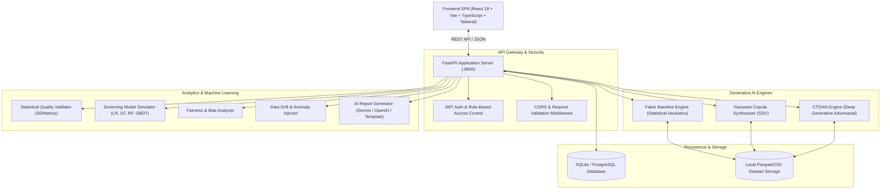
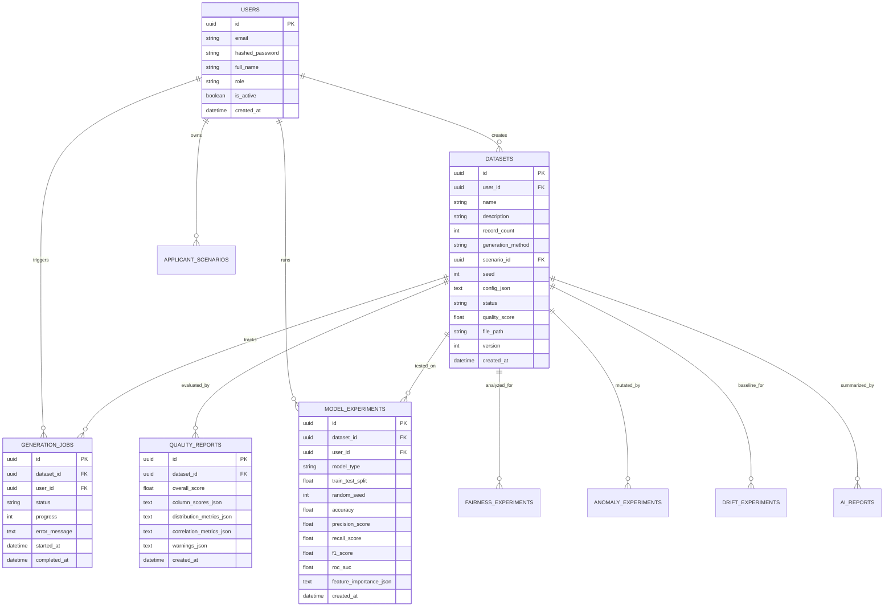
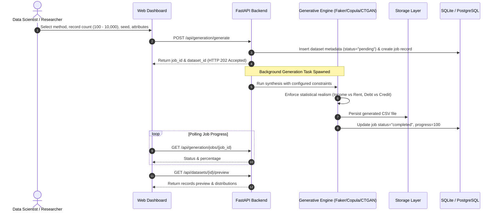
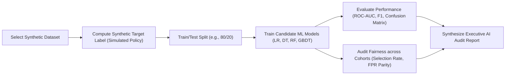

# TenantSynth AI – Synthetic Rental Application Generator

[](https://fastapi.tiangolo.com)
[](https://react.dev)
[](https://vitejs.dev)
[](https://tailwindcss.com)
[](https://sdv.dev)
[](https://opensource.org/licenses/MIT)

> **⚠️ RESEARCH & TESTING NOTICE**: TenantSynth AI is strictly an AI research, statistical benchmarking, and model evaluation platform. All generated records are 100% fictional. It does NOT generate personally identifiable information (PII) and MUST NOT be used for real-world tenant screening, leasing approvals, or credit underwriting.

---

## 📌 Table of Contents
1. [Project Overview](#project-overview)
2. [Problem Statement](#problem-statement)
3. [Key Objectives](#key-objectives)
4. [Architecture & Workflow Diagrams](#architecture--workflow-diagrams)
   - [System Architecture](#system-architecture)
   - [Database Entity Relationship Diagram](#database-entity-relationship-diagram)
   - [Synthetic Data Generation Workflow](#synthetic-data-generation-workflow)
   - [ML Screening & Fairness Workflow](#ml-screening--fairness-workflow)
5. [Feature Capabilities](#feature-capabilities)
6. [Technology Stack](#technology-stack)
7. [Installation & Setup](#installation--setup)
   - [Prerequisites](#prerequisites)
   - [Backend Setup](#backend-setup)
   - [Frontend Setup](#frontend-setup)
   - [Environment Variables](#environment-variables)
8. [Usage Guide](#usage-guide)
9. [API Documentation](#api-documentation)
10. [Testing Suite](#testing-suite)
11. [Ethical Safeguards & Privacy Guarantees](#ethical-safeguards--privacy-guarantees)
12. [Troubleshooting & FAQ](#troubleshooting--faq)
13. [Limitations & Future Roadmap](#limitations--future-roadmap)

---

## 🏢 Project Overview

**TenantSynth AI** is an enterprise-grade, full-stack Generative AI platform engineered to synthesize high-fidelity tabular rental application datasets. Designed specifically for property technology (PropTech) researchers, risk modelers, and data scientists, TenantSynth AI provides a secure, sandboxed testing environment to stress-test automated screening algorithms, evaluate algorithmic fairness, and simulate market distribution shifts without risking sensitive tenant privacy or violating fair housing regulations.

---

## ⚠️ Problem Statement

Modern property management systems increasingly evaluate automated tenant-screening and risk-assessment models. However:
1. **Severe Privacy Concerns & PII Sensitivity**: Real rental applications contain highly sensitive personal information (financial accounts, tax forms, credit scores, residential history). Exposing or pooling these records creates severe GDPR, CCPA, and FCRA liabilities.
2. **Cold-Start & Limited Data in New Markets**: Property developers and underwriting teams expanding into new metropolitan regions face critical training data deficits.
3. **Algorithmic Bias & Regulatory Non-Compliance**: Traditional screening models can unintentionally reproduce systemic socio-economic biases. Researchers lack controlled, privacy-safe benchmark datasets to audit models across diverse edge cases.

**TenantSynth AI** solves this by providing mathematically rigorous, statistically coherent synthetic applicant populations with multi-dimensional correlation fidelity and full demographic privacy preservation.

---

## 🎯 Key Objectives

- **Statistical Coherence**: Guarantee multi-attribute realistic correlations (e.g., income-to-rent consistency, credit score-to-delinquency dynamics, employment stability).
- **Multiple Generative Engines**: Provide Faker baseline, Gaussian Copula, and CTGAN (Conditional Tabular Generative Adversarial Network) architectures.
- **Scenario Injection**: Enable custom stress-testing via 10 preset applicant profiles (e.g., Freelancer with Variable Income, First-Time Renter, High Debt Burden).
- **Statistical Quality Validation**: Quantify synthetic data realism using mean/std deviations, Chi-squared distributions, and Pearson correlation matrices.
- **Fairness & Bias Benchmarking**: Audit ML screening models for Disparate Impact, False Positive Rate parity, and Equalized Odds across controlled cohorts.
- **Controlled Anomaly & Drift Simulation**: Inject synthetic edge cases and simulate macroeconomic shocks (e.g., inflation surges, gig economy expansion).
- **Executive AI Reporting**: Automatically generate analytical summaries using Google Gemini / OpenAI with an intelligent deterministic fallback.

---

## 📐 Architecture & Workflow Diagrams

### System Architecture



---

### Database Entity Relationship Diagram



---

### Synthetic Data Generation Workflow



---

### ML Screening & Fairness Workflow



---

## ⚡ Feature Capabilities

### 1. Multi-Engine Synthetic Generator
- **Faker Baseline**: Blazing fast generation based on empirical distributions and multi-field conditional bounds.
- **Gaussian Copula**: Models joint multivariate distributions and preserves linear and non-linear rank correlations using covariance transformations.
- **CTGAN (Conditional GAN)**: Deep neural architecture designed for tabular data with multimodal continuous columns and imbalanced categorical fields.

### 2. Scenario Presets & Builder
10 domain-specific real estate scenarios:
- **Stable Salaried Employment**: High income stability, prime credit (700+), debt-to-income < 30%.
- **Self-Employed Applicant**: Higher income variability, multi-year business reserves, variable rent ratios.
- **Freelancer with Variable Income**: Irregular monthly compensation, robust liquid savings.
- **First-Time Renter**: Zero prior landlord rental references, short credit duration, co-signer indicators.
- **Limited Credit History**: Young workforce profiles, thin credit file, compensatory document completeness.
- **Long-Term Rental History**: 5+ years tenure, pristine payment records.
- **Irregular Income Scenario**: Gig economy workers with fluctuating deposits.
- **High Debt Scenario**: Student loan or medical debt burdens (DTI > 45%).
- **Missing Documentation Scenario**: Simulates incomplete paperwork (up to 30% missingness).
- **Mixed Applicant Population**: General urban market demographic blend.

### 3. Data Quality & Statistical Validation
- Column-level similarity comparisons (Mean, Standard Deviation, Min, Max).
- Kolmogorov-Smirnov continuous distribution tests.
- Categorical frequency distribution cross-entropy.
- Pearson & Spearman correlation matrix similarity score.
- Missingness rate validation and duplicate record audit.

### 4. Experimental ML Screening Simulator
- Train Logistic Regression, Decision Trees, Random Forests, and Gradient Boosting Classifiers.
- Documented synthetic target policy (`likely_qualified`) based purely on objective risk heuristics.
- Interactive Confusion Matrix, ROC-AUC curve plotting, and Feature Importance bar charts.
- **Strict Ethical Isolation**: No protected characteristics (race, gender, familial status) are ever utilized.

### 5. Algorithmic Fairness & Bias Auditing
- Computes **Disparate Impact Ratio**, **Selection Rate**, and **Error Rate Parity** across cohorts.
- Visualizes False Positive Rate (FPR) and False Negative Rate (FNR) discrepancies.
- Educates practitioners on fair underwriting thresholds under the Fair Housing Act (FHA).

### 6. Anomaly Injection & Drift Simulator
- **Anomaly Types**: Hyper-inflated incomes, mathematically impossible rent-to-income splits, severe credit delinquency contradictions.
- **Drift Simulation**: Simulates macroeconomic shifts (e.g., rent increases of +25%, gig-worker surges).

### 7. AI Executive Report Generator
- Multi-tier LLM integration: Automatically generates executive narratives via **Google Gemini API** or **OpenAI API**.
- Includes a **Deterministic Local Template Fallback** providing comprehensive markdown reports even with zero API keys configured.

---

## 🛠️ Technology Stack

| Layer | Technologies |
|---|---|
| **Frontend Framework** | React 18.2, Vite 5.2, TypeScript 5.2 |
| **Styling & Icons** | Tailwind CSS 3.4, Lucide React, Shadcn/UI Patterns |
| **Data Visualization** | Recharts 2.12 (Interactive Responsive SVG Charts) |
| **State & Networking** | React Router v6, Axios, React Hook Form, Zod |
| **Backend Framework** | FastAPI 0.111, Python 3.12, Uvicorn, Pydantic v2 |
| **Database & ORM** | SQLAlchemy 2.0, SQLite (Local Dev) / PostgreSQL (Production) |
| **Synthetic AI Engine** | SDV 2.2, CTGAN, Gaussian Copula, Faker 24 |
| **Machine Learning** | Scikit-learn 1.4, SciPy 1.13, NumPy 1.26, Pandas 2.2 |
| **AI LLM Services** | Google Generative AI SDK, OpenAI SDK, Built-in Rule Engine |

---

## 💻 Installation & Setup

### Prerequisites
- **Python**: 3.10, 3.11, or 3.12 installed
- **Node.js**: v18.0.0 or higher
- **npm** or **pnpm** installed

---

### Step 1: Clone or Navigate to the Repository

```powershell
cd "c:\Users\SATHVIK\OneDrive\Desktop\GEN AI PROJECT\tenantsynth-ai"
```

---

### Step 2: Backend Setup

1. Open PowerShell and navigate to the backend directory:
   ```powershell
   cd backend
   ```

2. (Optional but recommended) Create and activate a Python virtual environment:
   ```powershell
   python -m venv venv
   .\venv\Scripts\Activate.ps1
   ```

3. Install required Python packages:
   ```powershell
   python -m pip install -r requirements.txt
   ```

4. Configure the environment variables:
   ```powershell
   Copy-Item .env.example .env
   ```

5. Launch the FastAPI server:
   ```powershell
   python -m uvicorn app.main:app --host 127.0.0.1 --port 8000 --reload
   ```

   - Swagger Interactive Documentation: [http://localhost:8000/docs](http://localhost:8000/docs)
   - ReDoc Documentation: [http://localhost:8000/redoc](http://localhost:8000/redoc)
   - Healthcheck: [http://localhost:8000/health](http://localhost:8000/health)

---

### Step 3: Frontend Setup

1. Open a second PowerShell terminal and navigate to the frontend directory:
   ```powershell
   cd "c:\Users\SATHVIK\OneDrive\Desktop\GEN AI PROJECT\tenantsynth-ai\frontend"
   ```

2. Install npm dependencies:
   ```powershell
   npm install
   ```

3. Start the Vite development server:
   ```powershell
   npm run dev
   ```

4. Open your browser and navigate to:
   ```
   http://localhost:5173
   ```

---

## ⚙️ Environment Variables

Create or edit `backend/.env`:

```ini
# Database (Default: SQLite local database file)
DATABASE_URL=sqlite:///./tenantsynth.db

# Security & JWT Authentication
SECRET_KEY=tenantsynth-ultra-secure-secret-key-prod-2026
ALGORITHM=HS256
ACCESS_TOKEN_EXPIRE_MINUTES=60

# Optional Generative AI API Keys for Automated Reports
GEMINI_API_KEY=your_gemini_api_key_here
OPENAI_API_KEY=your_openai_api_key_here

# Network & Storage Settings
CORS_ORIGINS=["http://localhost:5173","http://localhost:3000","http://127.0.0.1:5173"]
MAX_RECORDS_LIMIT=50000
STORAGE_PATH=../storage
```

> **Note**: Even if no LLM API key is provided, the platform automatically switches to its **Deterministic Analytical Template Engine** to generate comprehensive reports without errors.

---

## 🚀 Usage Guide

1. **Register an Account**: Navigate to `http://localhost:5173/register` and create your researcher credentials.
2. **Dashboard Overview**: View platform-wide generation counts, quality scores, and recent model experiments.
3. **Generate Synthetic Data**:
   - Go to `/generate`.
   - Choose your generation technique: **Faker Baseline**, **Gaussian Copula**, or **CTGAN**.
   - Select record count (100, 500, 1,000, 5,000, or custom).
   - Adjust constraints: Monthly income range, rent range, credit score bounds, missing value rate.
   - Click **Generate Dataset**.
4. **Explore in Data Laboratory**: Go to `/laboratory` to filter, search, sort, and inspect column distributions.
5. **Validate Data Quality**: Go to `/quality` to run statistical fidelity checks against reference distributions.
6. **Screening Model Simulator**: Go to `/screening` to train candidate classification models and inspect ROC-AUC & confusion matrices.
7. **Fairness Audit**: Go to `/fairness` to inspect selection rates across demographic and household cohorts.
8. **Export Datasets**: Download your generated datasets in **CSV**, **Excel (XLSX)**, or **JSON** formats.
9. **Executive AI Reports**: Generate and download comprehensive evaluation reports in Markdown, JSON, or PDF.

---

## 📡 API Documentation

FastAPI provides an automatic, interactive OpenAPI documentation interface at:
- **Swagger UI**: `http://localhost:8000/docs`
- **ReDoc**: `http://localhost:8000/redoc`

### Key Endpoint Groups

| Category | Method | Path | Description |
|---|---|---|---|
| **Auth** | `POST` | `/api/auth/register` | Register a new user |
| **Auth** | `POST` | `/api/auth/login` | Obtain JWT bearer token |
| **Auth** | `GET` | `/api/auth/me` | Fetch authenticated profile |
| **Dashboard** | `GET` | `/api/dashboard/stats` | Aggregate metrics and counts |
| **Datasets** | `GET` | `/api/datasets` | Paginated list of datasets |
| **Datasets** | `GET` | `/api/datasets/{id}/preview` | Preview first 100 rows |
| **Generation** | `POST` | `/api/generation/generate` | Launch async synthesis job |
| **Generation** | `GET` | `/api/generation/jobs/{id}` | Poll background synthesis status |
| **Scenarios** | `GET` | `/api/scenarios` | List presets & custom scenarios |
| **Quality** | `POST` | `/api/quality/analyze/{id}` | Run statistical quality tests |
| **Models** | `POST` | `/api/models/train` | Train experimental screening model |
| **Fairness** | `POST` | `/api/fairness/analyze` | Run cohort disparate impact analysis |
| **Anomalies** | `POST` | `/api/anomalies/inject` | Inject edge-case mutations |
| **Drift** | `POST` | `/api/drift/simulate` | Simulate distribution shifts |
| **Reports** | `POST` | `/api/reports/generate/{id}` | Generate executive AI audit report |
| **Exports** | `GET` | `/api/exports/{id}/csv` | Stream dataset as CSV file |

---

## 🧪 Testing Suite

### Running Backend Tests
```powershell
cd backend
python -m pytest tests/ -v
```

The backend test suite covers:
- `test_auth.py`: Registration, login, JWT validation, and invalid credential handling.
- `test_generation.py`: Faker generation integrity, constraint bounds, and seed reproducibility.
- `test_quality.py`: Statistical similarity algorithms, correlation checks, and warning triggers.

### Running Frontend Tests & Typecheck
```powershell
cd frontend
npm run build
```
Validates TypeScript compilation across all 16 page modules, components, types, and hooks with zero errors.

---

## 🛡️ Ethical Safeguards & Privacy Guarantees

1. **Differential & Synthetic Isolation**:
   - Zero real tenant records are bundled or ingested.
   - All addresses, names, and identifiers are synthesized using non-referential cryptographic faker seeds.
2. **Fair Housing Compliance Safeguards**:
   - Protected categories (Race, Color, Religion, Sex, Disability, Familial Status, National Origin) are **never generated, stored, or utilized as predictive model features**.
   - Screening models strictly evaluate objective risk factors: debt-to-income ratio, rent-to-income ratio, verifiable income, and simulated payment scores.
3. **Clear Non-Deployment Disclaimer**:
   - The UI and API explicitly watermark all outputs with: *"Simulated Experimental Results Only – Not for Live Underwriting"*.

---

## ❓ Troubleshooting & FAQ

### 1. `python.exe` permission denied or Microsoft Store alias error
- **Cause**: Windows Execution Alias redirection.
- **Fix**: Run via `python -m ...` or ensure Python 3.12 path is placed above WindowsApps in your System Environment Variables.

### 2. SDV or PyTorch version conflicts
- **Fix**: Use the pinned versions in `requirements.txt` (`sdv==2.2.0`, `ctgan==0.9.0`). The platform automatically utilizes the Faker engine if deep generative libraries are unavailable.

### 3. Missing LLM API key
- **Behavior**: The backend smoothly falls back to deterministic mathematical report generation. You will never encounter a 500 error due to a missing Gemini or OpenAI key.

---

## 🗺️ Limitations & Future Roadmap

- **Multi-Property Grouping**: Future updates will support portfolio-wide multi-table synthesis (leases + tenants + maintenance requests).
- **Differential Privacy Budgeting**: Incorporating $(\epsilon, \delta)$-differential privacy guarantees for enterprise data sharing.
- **Time-Series Lease Delinquency**: Simulating multi-year monthly payment timelines per applicant.

---

## 📄 License
This project is licensed under the MIT License - see the LICENSE file for details.
TenantSynth AI © 2026. All rights reserved.
